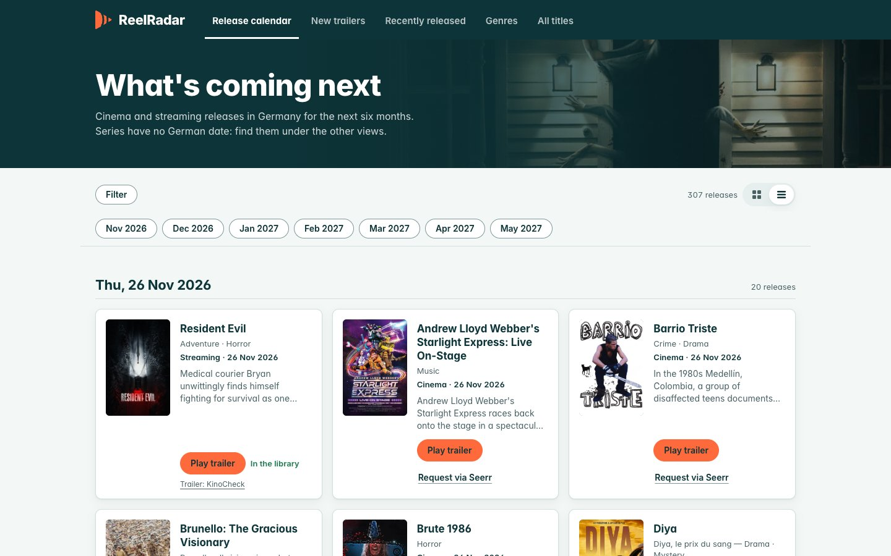
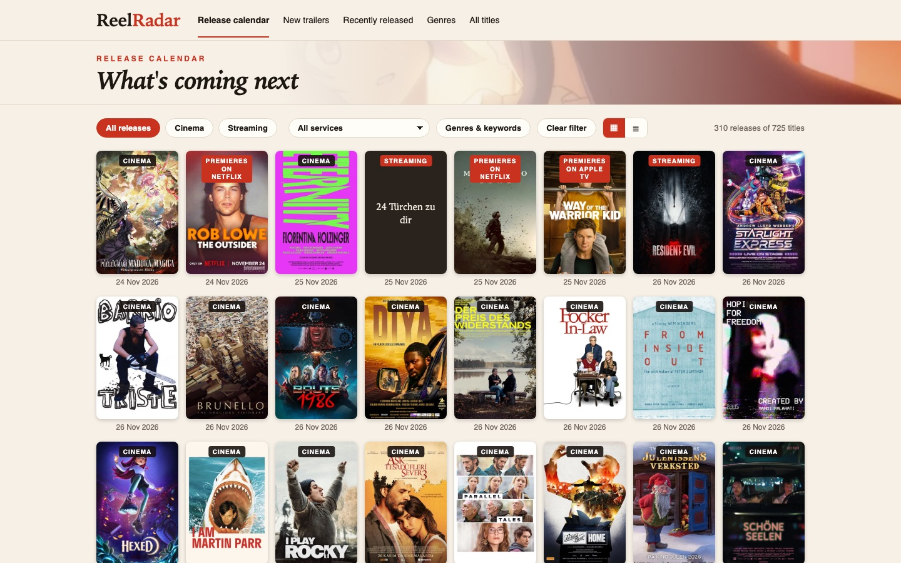
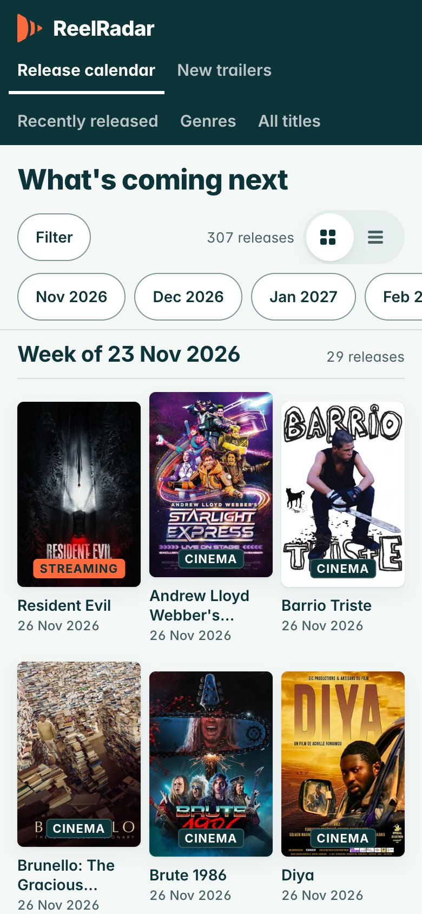
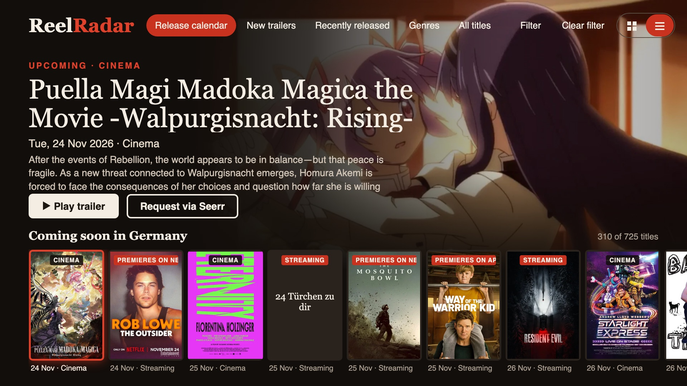
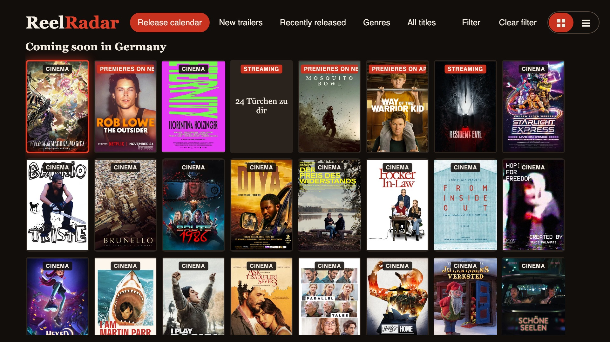

<p align="center">
  <picture>
    <source media="(prefers-color-scheme: dark)" srcset="docs/wordmark-dark.png">
    
  </picture>
</p>

<p align="center">
  A self-hosted movie and TV discovery service, inspired by the discontinued Apple Trailers experience.<br>
  See what is coming to German cinemas and streaming services, watch the trailer, and request it from Seerr.
</p>

## What it does

- **Release calendar** of German cinema and streaming releases for the next six months, plus new trailers, recently released, genres and all titles.
- **Movies and series**, imported daily from TMDB and KinoCheck, with "Premieres on Netflix / Apple TV / ..." where a service has announced a date.
- **Trailers play from your own cache**: each trailer is downloaded once, transcoded to HEVC and served from the LAN, so the TV needs no YouTube player.
- **One click to Seerr**: see whether a title is requested or in the library, and request it.
- **Three front ends, one backend**: a responsive web page, a phone layout, and a fullscreen Samsung Tizen TV app driven by arrows, OK and Back.

## Screenshots

**Web**

| Release calendar | Poster wall |
| --- | --- |
|  |  |

**Mobile**



**TV (Samsung Tizen)**

| Hero and rows | Poster wall |
| --- | --- |
|  |  |

## Run

Docker Compose stack: `backend` (Node 24, SQLite in the `reelradar-data` volume) and `frontend` (nginx: web page, trailer cache at `/media/`, proxy for `/api/`). The frontend listens on `127.0.0.1:8180` only.

```sh
cp .env.example .env     # fill in TMDB_API_KEY, KINOCHECK_API_KEY, SEERR_URL, SEERR_API_KEY
docker compose up -d --build
curl http://127.0.0.1:8180/api/health
```

To expose it on the LAN behind an existing Caddy, append `deploy/Caddyfile.example` (plain HTTP on `:8095`, private ranges only), validate, and reload.

Frontend JS must stay ES5 (Tizen 4.0 / Chromium M56).

## Configuration (`.env`)

| Variable | Purpose |
| --- | --- |
| `TMDB_API_KEY` | Required for the import. |
| `KINOCHECK_API_KEY` | Optional, but needed at this volume (1,000 requests/day without it). |
| `SEERR_URL`, `SEERR_API_KEY` | Seerr connection. The key never reaches the browser. |
| `IMPORT_TIME` | Daily import time, default `04:00` (Europe/Berlin). Newly picked trailers are cached afterwards. |
| `IMPORT_ON_START=1` | Also import when the backend starts. |
| `IMPORT_EXTRA_IDS`, `IMPORT_EXTRA_TV_IDS` | Comma-separated extra TMDB movie / series IDs. |
| `IMPORT_TV_PAGES` | Pages of series per discover query, default 3. |
| `KINOCHECK_TRIM=1` | Cut KinoCheck's intro and outro from their trailers (see `backend/kinocheck.js`). Off by default. |

Run an import by hand with `docker compose exec backend node import.js`. Allow/deny overrides live in `backend/lists.json`; service names for "Premieres on X" are mapped in `backend/expected-providers.json`.

## Trailers

The backend downloads each trailer once with yt-dlp, transcodes it to HEVC/AAC MP4 with ffmpeg, and nginx serves it at `/media/<key>.mp4`. `GET /api/stream/<movie|tv>/<tmdb_id>` returns its URL, downloading on first request. If YouTube refuses a video, the next candidate is tried: original language first (subtitled before dubbed), then English, German, others.

Pre-fill the cache after an import (about 30 MB per trailer; never pruned):

```sh
docker compose exec -T backend node prefetch.js
```

These are cached copies of YouTube videos for private household use. Never expose `/media/` or `/api/stream/` beyond the LAN.

## TV app (Tizen)

`tv-app/` is the Samsung TV app (`reelradar1.ReelRadar`). Set its API address at the top of `tv-app/index.html`, then build and install with the Tizen Studio CLI:

```sh
tizen package -t wgt -s hideki -o out -- tv-app/
sdb connect 192.168.42.54:26101
tizen install -n ReelRadar.wgt -s 192.168.42.54:26101 -- out
```

To preview it in a desktop browser, serve `tv-app/` over HTTP (`.claude/launch.json` has an entry on port 8765).

## Seerr

Each title shows its Seerr state (requested, partly in the library, in the library) and a request button. A series request asks for its first regular season only.

- `GET /api/seerr` returns the state per `movie:<id>` / `tv:<id>`, cached for a minute.
- `POST /api/request/<movie|tv>/<tmdb_id>` sends the request. POSTs from another website's `Origin` are refused.

## Notes

- Series have no German dates, so they appear in New trailers, Genres and All titles, and under Streaming while a German service lists them.
- The genre/keyword filter is stored in the browser (`localStorage`); the server keeps no per-user data.

This product uses the TMDB API but is not endorsed or certified by TMDB. KinoCheck trailers link back to KinoCheck as their source.
